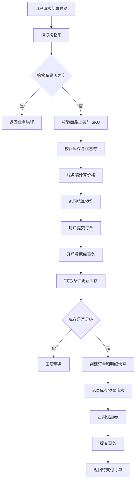
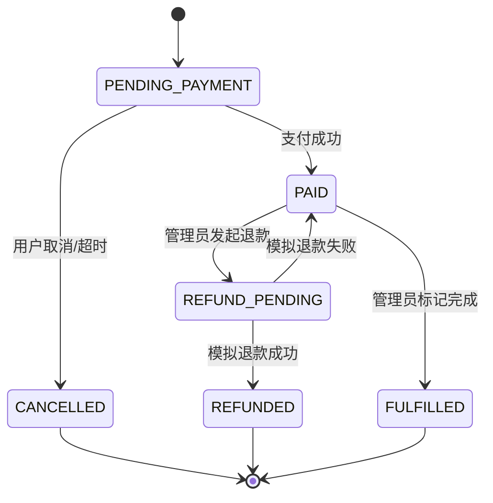
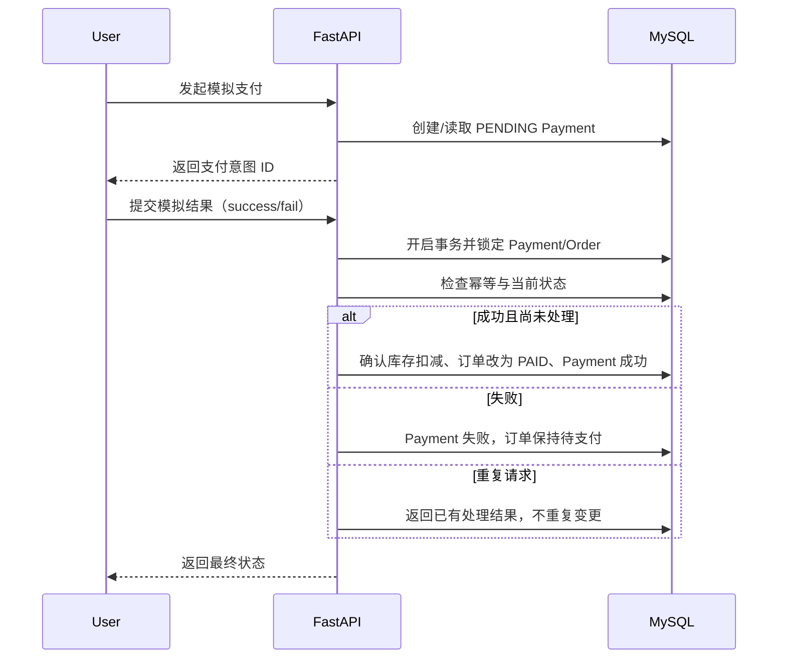

# 03 — 业务流程与领域模型

## 1. 核心领域

| 领域 | 职责 | 主要对象 |
|---|---|---|
| Identity | 身份认证与授权 | User, Role |
| Catalog | 商品目录 | Product, Category, ProductVariant |
| Inventory | 库存与流水 | Inventory, InventoryMovement |
| Cart | 购物车 | Cart, CartItem |
| Order | 订单与订单明细 | Order, OrderItem |
| Payment | 模拟支付与退款 | Payment, Refund |
| Promotion | 优惠券 | Coupon, CouponRedemption |

## 2. 核心关系

- 一个 Product 属于一个 Category（第一版简化；未来可扩展多分类）。
- 一个 Product 有一个或多个 ProductVariant。
- 一个 ProductVariant 对应一个唯一 SKU。
- 一个 ProductVariant 在单仓库模式下对应一条 Inventory。
- 一个用户有一个活动 Cart；Cart 包含多个 CartItem。
- 一个 Order 包含多个 OrderItem；OrderItem 保存商品与 SKU 快照。
- 一个 Order 可有一条或多条 Payment 记录（第一版建议限制一个成功支付）。
- Coupon 与用户的核销关系通过 CouponRedemption 表记录。

## 3. 结算与下单流程

### 下单事务边界

一个订单创建事务至少包含：
1. 校验购物车项及商品当前状态。
2. 重新读取并计算价格。
3. 以安全的并发方式预留库存。
4. 创建订单和订单明细快照。
5. 创建待支付记录或支付意图。
6. 占用优惠券（若已实现）。
7. 写库存流水。
8. 提交事务。

任一关键步骤失败，整个事务回滚。不要先提交订单，再在事务外扣库存。

## 4. 库存状态与操作

第一版库存模型：

- `on_hand`：实物数量。
- `reserved`：预留数量。
- `available`：计算值，不必持久化，等于 `on_hand - reserved`。

操作：

| 事件 | on_hand | reserved | 说明 |
|---|---:|---:|---|
| 管理员入库 +5 | +5 | 不变 | 写 ADJUST_IN 流水 |
| 下单预留 2 | 不变 | +2 | available 减少 |
| 支付成功 2 | -2 | -2 | 预留转为销售 |
| 取消/超时 2 | 不变 | -2 | 释放预留 |
| 管理员盘亏 1 | -1 | 不变 | 必须校验不能低于 reserved |

并发控制建议：使用 `SELECT ... FOR UPDATE` 锁定库存行，或使用带条件的原子 UPDATE（例如仅当 `on_hand - reserved >= qty` 时更新），并检查受影响行数。具体方案在 ADR 中确认。

## 5. 订单状态机

第一版建议：

约束：
- `CANCELLED`、`REFUNDED`、`FULFILLED` 为终态（第一版不提供重新打开）。
- 用户仅可取消 `PENDING_PAYMENT`。
- `PAID` 不可直接取消，需走退款。
- 所有状态迁移记录操作者、时间、原状态、新状态和原因（可使用 order_events 表或通用审计表）。

## 6. 支付模拟流程

注意：模拟支付接口只用于学习业务状态与幂等处理，不代表真实支付安全模型。

## 7. 必须提前讨论的边界情况

- 同一 SKU 被两个用户同时购买，库存只剩 1。
- 用户连续两次提交相同订单请求。
- 支付成功请求重复到达。
- 订单取消与支付成功同时发生。
- 管理员调整库存时存在未支付订单预留。
- 商品下架后，购物车仍有该商品。
- 优惠券最后一个名额被多个用户同时领取。
- 订单创建事务中途失败。
