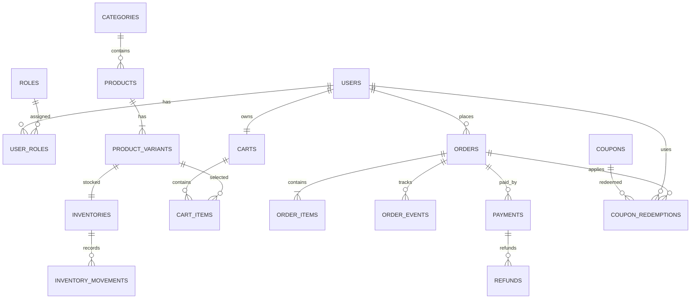

# 04 — 数据库设计（初稿）

> 数据库：MySQL 8.x；存储引擎：InnoDB；字符集：utf8mb4。  
> 这是逻辑模型初稿。最终字段、索引和约束需在实现前通过 ERD 工具校正。

## 1. 表清单

| 表 | 用途 | 关键关系 |
|---|---|---|
| users | 用户 | 1:N orders, 1:1 cart |
| roles | 角色 | M:N users |
| user_roles | 用户角色关联 | users ↔ roles |
| categories | 商品分类 | 自关联 parent_id |
| products | 商品 | N:1 categories |
| product_variants | SKU/变体 | N:1 products |
| inventories | 单仓库存 | 1:1 product_variants |
| inventory_movements | 库存流水 | N:1 inventories |
| carts | 购物车 | 1:1 users（活动购物车） |
| cart_items | 购物车项 | N:1 carts, N:1 variants |
| orders | 订单 | N:1 users |
| order_items | 订单明细快照 | N:1 orders |
| order_events | 订单状态历史 | N:1 orders |
| payments | 支付记录 | N:1 orders |
| refunds | 退款记录 | N:1 payments |
| coupons | 优惠券 | 1:N redemptions |
| coupon_redemptions | 优惠券占用/核销 | N:1 coupons, N:1 users, N:1 orders |

## 2. 字段设计建议

### users
- id BIGINT UNSIGNED PK
- email VARCHAR(255) NOT NULL UNIQUE
- username VARCHAR(64) NOT NULL UNIQUE
- password_hash VARCHAR(255) NOT NULL
- is_active BOOLEAN NOT NULL DEFAULT TRUE
- created_at, updated_at DATETIME(6)

### roles / user_roles
- roles: id, name UNIQUE, description
- user_roles: user_id, role_id；联合唯一约束 `(user_id, role_id)`

### categories
- id, parent_id NULL, name, slug UNIQUE, is_active, created_at, updated_at
- parent_id 自关联 categories.id；应用层禁止循环引用。

### products
- id, category_id, name, slug UNIQUE, description TEXT, status, created_at, updated_at
- status：DRAFT / ACTIVE / ARCHIVED

### product_variants
- id, product_id, sku UNIQUE, name, price DECIMAL(12,2), is_active, created_at, updated_at
- 价格必须大于等于 0；库存不放在 variant 表中。

### inventories
- id, variant_id UNIQUE, on_hand INT UNSIGNED, reserved INT UNSIGNED, updated_at
- 约束/业务校验：reserved <= on_hand；available = on_hand - reserved。
- 并发更新通过行锁或条件 UPDATE 实现。

### inventory_movements
- id, inventory_id, order_id NULL, movement_type, quantity_delta, on_hand_after, reserved_after, reason, created_at, actor_user_id NULL
- movement_type：ADJUST_IN / ADJUST_OUT / RESERVE / RELEASE / SALE
- 用于审计，不允许无流水地修改库存。

### carts / cart_items
- carts: id, user_id UNIQUE, status, created_at, updated_at
- cart_items: id, cart_id, variant_id, quantity, created_at, updated_at
- 联合唯一约束 `(cart_id, variant_id)`；quantity > 0。

### orders
- id BIGINT UNSIGNED PK
- order_no VARCHAR(32) UNIQUE
- user_id FK
- status
- currency CHAR(3) DEFAULT 'CNY'
- subtotal DECIMAL(12,2)
- discount_total DECIMAL(12,2) DEFAULT 0
- total_amount DECIMAL(12,2)
- idempotency_key VARCHAR(64) NULL
- created_at, updated_at, cancelled_at NULL
- 若启用幂等键，建议 `(user_id, idempotency_key)` 唯一。

### order_items
- id, order_id, variant_id NULL
- product_name_snapshot, sku_snapshot, variant_name_snapshot
- unit_price DECIMAL(12,2), quantity INT UNSIGNED, line_total DECIMAL(12,2)
- variant_id 可空是为了保留商品删除后的历史订单；也可采用软删除策略。

### order_events
- id, order_id, from_status NULL, to_status, actor_user_id NULL, reason, created_at

### payments
- id, order_id, payment_no UNIQUE, method, status, amount DECIMAL(12,2), idempotency_key NULL UNIQUE, created_at, updated_at
- 第一版只实现 MOCK 方法。

### refunds
- id, payment_id, refund_no UNIQUE, amount DECIMAL(12,2), status, reason, created_at, updated_at

### coupons / coupon_redemptions
- coupons: id, code UNIQUE, discount_type, discount_value DECIMAL(12,2), min_order_amount DECIMAL(12,2), total_limit NULL, per_user_limit, starts_at, expires_at, is_active
- coupon_redemptions: id, coupon_id, user_id, order_id NULL, status, reserved_at, redeemed_at NULL
- 使用数据库唯一约束和事务防止超发/重复核销；具体计数方案在实现前确定。

## 3. 索引建议

- users(email)、users(username)：唯一索引。
- products(status, category_id)、products(slug)：查询索引/唯一索引。
- product_variants(sku)：唯一索引；(product_id, is_active) 普通索引。
- carts(user_id)：唯一索引。
- cart_items(cart_id, variant_id)：联合唯一索引。
- orders(order_no)：唯一索引；(user_id, created_at)；(status, created_at)。
- order_items(order_id)。
- inventory_movements(inventory_id, created_at)；(order_id)。
- payments(order_id, created_at)。
- coupons(code)：唯一索引。

索引应根据实际查询与 `EXPLAIN` 结果调整，不要只因为字段常被查询就全部加索引。

## 4. ERD（逻辑关系示意）

## 5. 数据库设计待确认项

- 订单号生成策略：随机唯一号或时间有序 ID；不能依赖自增 ID 暴露业务序号。
- 删除策略：商品、用户、订单优先软删除/禁用，避免破坏历史订单。
- 是否保留收货地址快照：建议订单中保存下单时地址快照，后续增加 `order_addresses`。
- 优惠券占用与核销：需明确超时释放机制。
- 是否启用软删除：不要全表机械添加；按业务历史要求决定。
- 时间统一存 UTC，API 输出 ISO 8601；展示时再转换时区。
