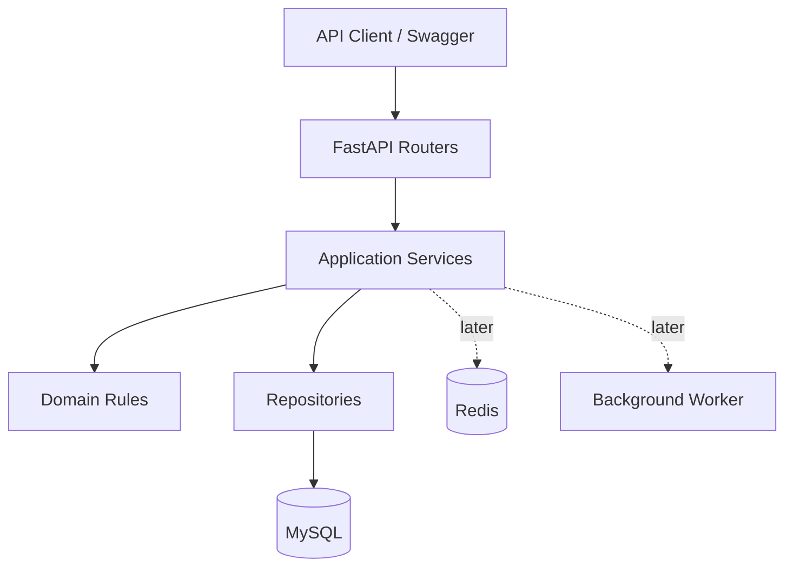

# 06 — 技术架构与决策

## 1. 总体架构

第一版采用模块化单体（Modular Monolith），单个 FastAPI 应用进程，按业务领域划分模块。不要在学习初期拆成微服务。



建议依赖方向：

`router -> service -> repository -> database`

领域规则放在 service/domain 层，不把复杂业务塞进 router 或 ORM model。

## 2. 技术选型

| 层 | 技术 | 用途 | 引入时机 |
|---|---|---|---|
| API | FastAPI | REST API、依赖注入、OpenAPI | 第一阶段 |
| Validation | Pydantic | 请求/响应 schema | 第一阶段 |
| ORM | SQLAlchemy 2.x | ORM 与 SQL | 第一阶段 |
| Database | MySQL 8.x / InnoDB | 事务与关系数据 | 第一阶段 |
| Migration | Alembic | schema 版本管理 | 第一阶段 |
| Auth | JWT + password hashing | 身份认证 | 第一阶段 |
| Testing | pytest + httpx | 单元/集成测试 | 第一阶段 |
| Cache | Redis | 缓存/后续限流等 | 核心业务稳定后 |
| Container | Docker Compose | 本地依赖环境 | 工程化阶段 |
| Worker | 可选 Celery / RQ / 原生任务方案 | 过期订单、异步任务 | 先评估再引入 |

不要在第一版同时引入 Celery、RabbitMQ、Kafka 等多套基础设施。后台任务可以先用明确的命令/脚本处理，确认需要后再引入队列。

## 3. 推荐目录结构

```text
saleor-fastapi/
├── src/
│   └── app/
│       ├── main.py
│       ├── core/                 # config、security、logging、exceptions
│       ├── db/                   # engine、session、base
│       ├── modules/
│       │   ├── auth/
│       │   ├── users/
│       │   ├── catalog/
│       │   ├── inventory/
│       │   ├── cart/
│       │   ├── orders/
│       │   ├── payments/
│       │   └── promotions/
│       └── common/               # 通用分页、响应等
├── migrations/                   # Alembic
├── tests/
│   ├── unit/
│   ├── integration/
│   └── api/
├── scripts/
├── docs/
├── .env.example
├── .gitignore
├── pyproject.toml
├── alembic.ini
└── README.md
```

模块内部可采用：

```text
catalog/
├── router.py
├── schemas.py
├── models.py
├── repository.py
└── service.py
```

不要为了形式强制每个模块都拆出大量空文件；随着复杂度增长再细分。

## 4. 架构决策记录（ADR）模板

每项重要技术选择记录：
- 标题与日期
- 状态：Proposed / Accepted / Superseded
- 背景与问题
- 备选方案
- 决策
- 后果与取舍
- 相关测试/验证

建议优先写这些 ADR：
1. 模块化单体，而不是微服务。
2. SQLAlchemy 2.x Session 与事务边界。
3. 库存并发控制：行锁 vs 条件 UPDATE。
4. 订单创建幂等策略。
5. 订单状态迁移的实现方式。
6. Redis 缓存哪些读路径，以及如何失效。

## 5. 初始配置原则

- 使用 `.env` 管理本地配置；提交 `.env.example`，不提交真实密钥。
- SQLAlchemy Session 生命周期由 FastAPI dependency 管理。
- 不在全局共享一个 Session。
- 事务由应用服务明确控制；避免 repository 内部隐式提交。
- 所有数据库写操作使用参数化 ORM/SQL。
- 日志记录 request_id、用户 ID（必要时）、业务对象 ID；不记录密码、token、支付敏感信息。
- 数据库时间统一 UTC，展示层处理本地时区。
